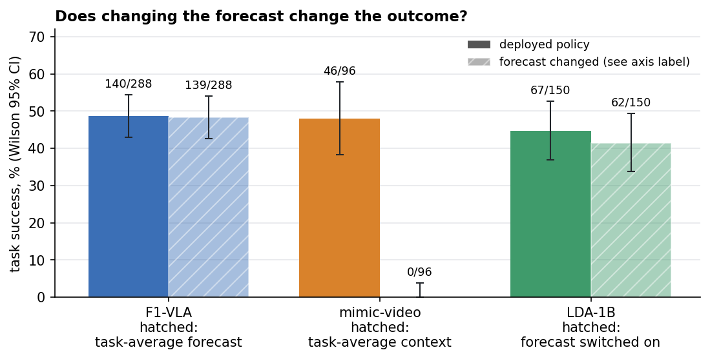
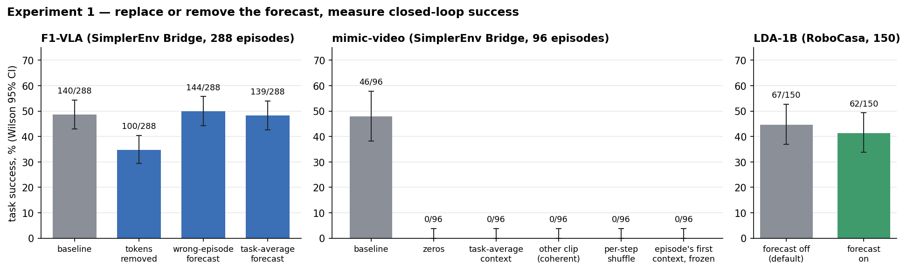
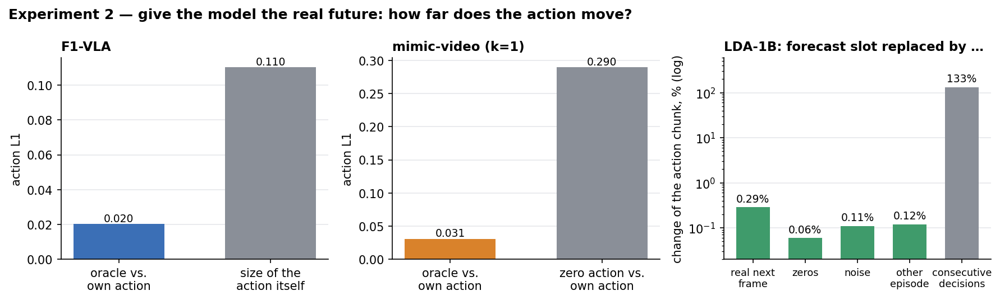
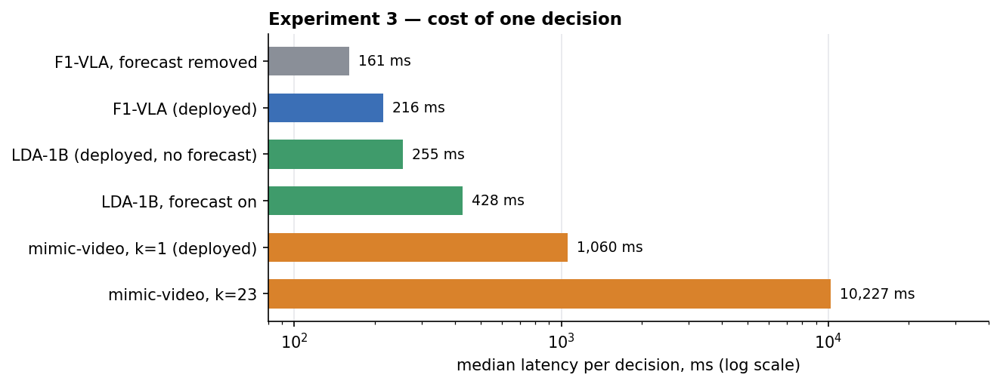
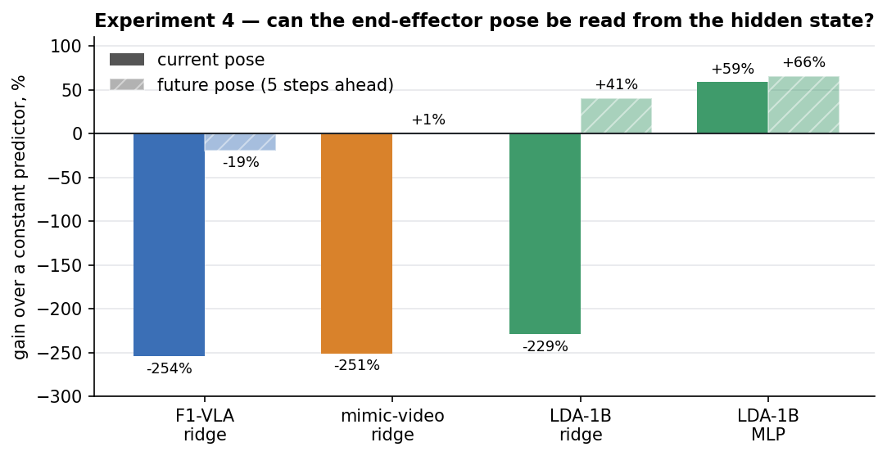
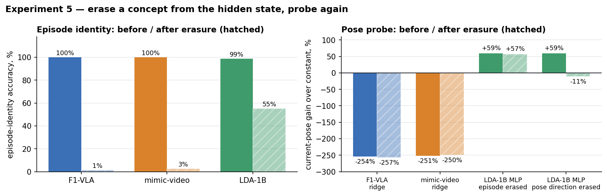
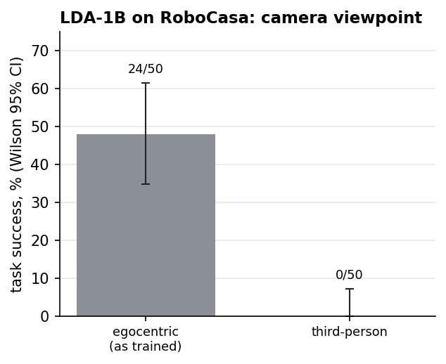
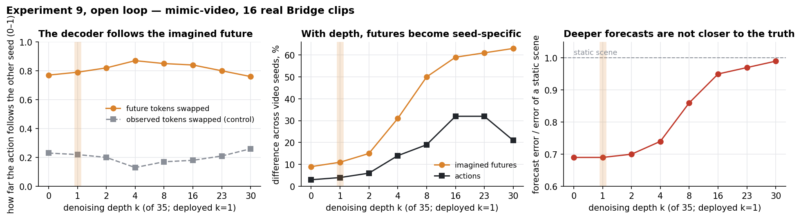
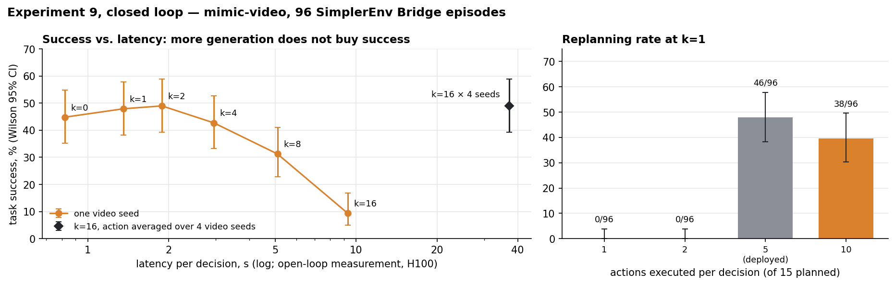

# Does Foresight Drive Action?

**Master's thesis (working draft).** Several recent robot policies predict the
future — an image, a video or a latent forecast — before they choose an
action, and report better results than action-only policies. This thesis
asks *why*: does the policy actually read its own forecast at the moment it
acts, or did learning to forecast only make its representations better,
with the forecast itself unused at inference?

Three models with three different kinds of forecast are put through one
shared set of experiments.



## What is in this repository

| Path | Content |
|---|---|
| [`thesis.md`](thesis.md) | The thesis text. Updated whenever a result lands in one of the model repositories. |
| [`figures/`](figures) | One figure per experiment, plus [`make_figures.py`](figures/make_figures.py), which rebuilds all of them from the reported numbers (no raw data needed). |
| [`notes/`](notes) | Working notes: status of the advisor's task list, explanations of individual checks. Partly in Russian. |

Code, logs and the full per-experiment write-ups live in the three model
repositories:

| Model | Class (Shen et al., 2026, arXiv:2606.20781) | Repository and branch | Experiment records |
|---|---|---|---|
| F1-VLA | Render-and-Decode | [Coldilger/F1-VLA @ `bridge-finetune`](https://github.com/Coldilger/F1-VLA/tree/bridge-finetune) | [`eval/bridge/`](https://github.com/Coldilger/F1-VLA/tree/bridge-finetune/eval/bridge) |
| mimic-video | Latent-Only | [Coldilger/mimic-video @ `main`](https://github.com/Coldilger/mimic-video/tree/main) | [`eval/bridge/`](https://github.com/Coldilger/mimic-video/tree/main/eval/bridge) |
| LDA-1B | Video-Generation-Free | [Coldilger/LDA-1B @ `bridge-finetune`](https://github.com/Coldilger/LDA-1B/tree/bridge-finetune) | [`eval/bridge/`](https://github.com/Coldilger/LDA-1B/tree/bridge-finetune/eval/bridge), [`eval/robocasa/`](https://github.com/Coldilger/LDA-1B/tree/bridge-finetune/eval/robocasa) |

The placement of the three models in the survey's classes still has to be
checked against its Tables 1–2.

## Findings so far

None of the three models gives evidence that the *predicted future* is what
drives the action.

- **F1-VLA needs the forecast's slot, not its content.** Replacing the
  forecast with the task average leaves success unchanged (139/288 vs.
  140/288). Removing the tokens costs 14 pp, but only because the input
  becomes shorter than anything seen in training. In the released code only
  4 of the 10 scales are generated (30 tokens, finest grid 4×4) and the pixel
  decoder is commented out ([note](notes/f1_category_code_check.md)).
- **mimic-video depends on its video model's context, and deeper forecasts
  hurt.** Every replacement of the context gives 0/96, but at the deployed
  setting (one denoising step) forecast and perception share the same tokens.
  Generating the forecast further lowers success (9/96 at 16 steps) because
  the decoder commits to one imagined future; averaging over four futures
  brings it back to 47/96.
- **LDA-1B does not use its forecast at inference.** Switching the dormant
  forecast on gives 62/150 vs. 67/150; replacing it with the real next
  frame changes the action by 0.3%.

Whether forecasting helped *during training* has not been measured for any
model (Experiment 11, not started).

## Experiments

Benchmarks: SimplerEnv Bridge, 4 tasks × 24 episodes (F1-VLA with 3 seeds =
288, mimic-video = 96); RoboCasa GR1 tabletop, 150 seeded episodes (LDA-1B).
Every condition runs on the same episodes as its baseline; intervals are
Wilson 95%, differences are paired.

### Experiment 1 — Ablation: replace or remove the forecast



F1-VLA is indifferent to forecast content, mimic-video collapses under every
replacement, LDA-1B is unaffected. Thesis §5.1 ·
[F1-VLA](https://github.com/Coldilger/F1-VLA/blob/bridge-finetune/eval/bridge/experiment1_ablation/README.md) ·
[mimic-video](https://github.com/Coldilger/mimic-video/blob/main/eval/bridge/experiment1_ablation/README.md) ·
[LDA-1B](https://github.com/Coldilger/LDA-1B/blob/bridge-finetune/eval/robocasa/RESULTS.md)

### Experiment 2 — Oracle: give the model the real future



Given the real next frame, each model's action stays close to what it did
with its own forecast. Live probes on single tasks; this section of the
thesis (§5.2) is the oldest and is marked for re-checking. Offline
comparisons with dataset actions are not used anywhere. ·
[F1-VLA](https://github.com/Coldilger/F1-VLA/blob/bridge-finetune/eval/bridge/experiment2_oracle/ORACLE_EXPERIMENT.md) ·
[mimic-video](https://github.com/Coldilger/mimic-video/blob/main/eval/bridge/experiment2_oracle/ORACLE_EXPERIMENT.md) ·
[LDA-1B](https://github.com/Coldilger/LDA-1B/blob/bridge-finetune/eval/robocasa/internals/README.md)

### Experiment 3 — Cost of one decision



Thesis §5.3 ·
[F1-VLA](https://github.com/Coldilger/F1-VLA/blob/bridge-finetune/eval/bridge/experiment3_cost/README.md) ·
[mimic-video](https://github.com/Coldilger/mimic-video/blob/main/eval/bridge/experiment3_cost/README.md) ·
[LDA-1B](https://github.com/Coldilger/LDA-1B/blob/bridge-finetune/eval/bridge/experiment3_cost/README.md)

### Experiment 4 — Probing: can the pose be read from the hidden state?



Only LDA-1B's hidden state lets a probe recover the end-effector pose.
Thesis §5.4 ·
[F1-VLA](https://github.com/Coldilger/F1-VLA/blob/bridge-finetune/eval/bridge/experiment4_probing/README.md) ·
[mimic-video](https://github.com/Coldilger/mimic-video/blob/main/eval/bridge/experiment4_probing/README.md) ·
[LDA-1B](https://github.com/Coldilger/LDA-1B/blob/bridge-finetune/eval/bridge/experiment4_probing/README.md)

### Experiment 5 — Concept erasure



Erasing episode identity does not make the pose readable in F1-VLA or
mimic-video; in LDA-1B most of the pose signal is one linear direction.
Thesis §5.5 ·
[F1-VLA](https://github.com/Coldilger/F1-VLA/blob/bridge-finetune/eval/bridge/experiment5_erasure/README.md) ·
[mimic-video](https://github.com/Coldilger/mimic-video/blob/main/eval/bridge/experiment5_erasure/README.md) ·
[LDA-1B](https://github.com/Coldilger/LDA-1B/blob/bridge-finetune/eval/bridge/experiment5_erasure/README.md)

### LDA-1B and camera viewpoint



Thesis §5.6 · [LDA-1B](https://github.com/Coldilger/LDA-1B/blob/bridge-finetune/eval/robocasa/RESULTS.md)

### Experiment 9 — Compute vs. performance (mimic-video)





Success is flat for 0–4 denoising steps and falls from 8 steps on, while
latency grows from 1.4 s to 9.3 s. Thesis §6.4 ·
[mimic-video](https://github.com/Coldilger/mimic-video/blob/main/eval/bridge/experiment9_depth/README.md).
Not done yet for F1-VLA and LDA-1B.

### Planned, no results yet

| Experiment | Question | Thesis |
|---|---|---|
| 6 — Graded foresight replacement | How wrong may the forecast be? | §6.1 |
| 7 — Horizon-shifted foresight | Does the timing of the forecast matter? | §6.2 |
| 8 — Instruction–foresight conflict | Does the action follow the instruction or the forecast? | §6.3 |
| 10 — Perturbed starts | Is foresight useful when the robot has to adapt? | §6.5 |
| 11 — Matched action-only baseline | Did forecasting help during training? | §6.6 |
| 12 — BridgeData pipeline audit | Is LDA-1B's 0% on Bridge a data-processing difference? | §6.7 |

## Rebuilding the figures

```bash
python figures/make_figures.py
```
