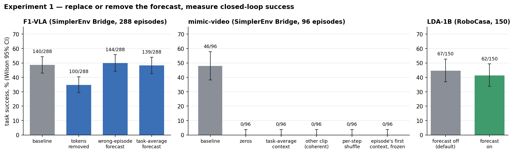
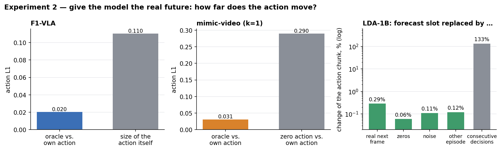
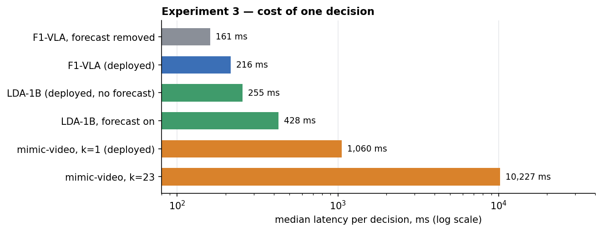
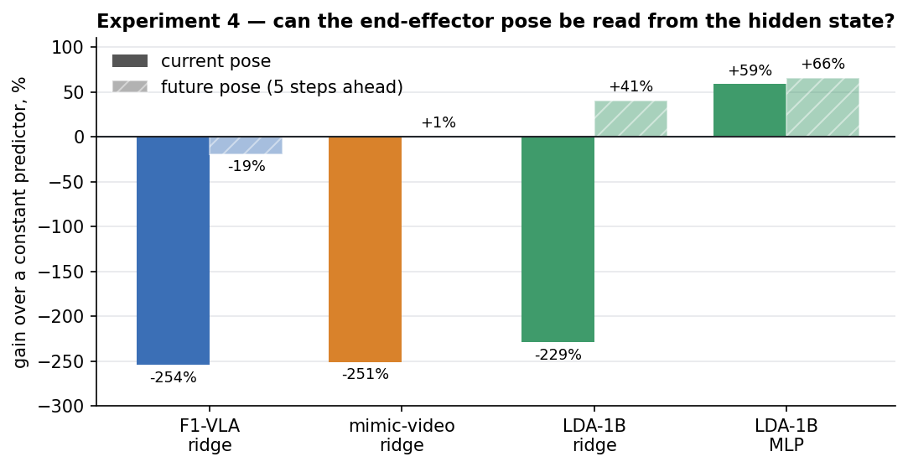
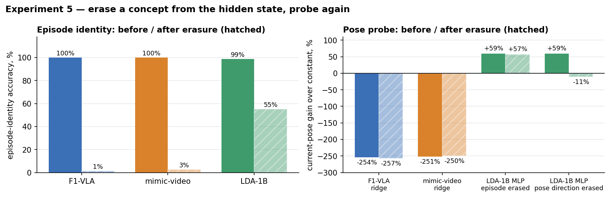
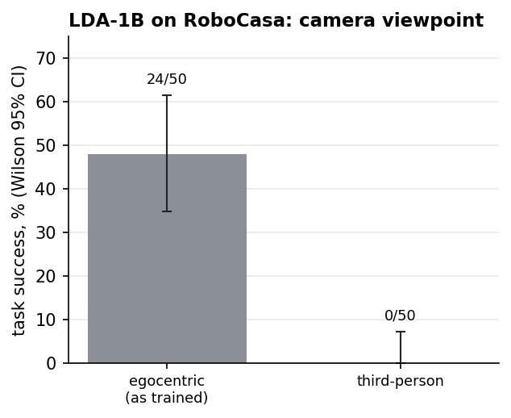
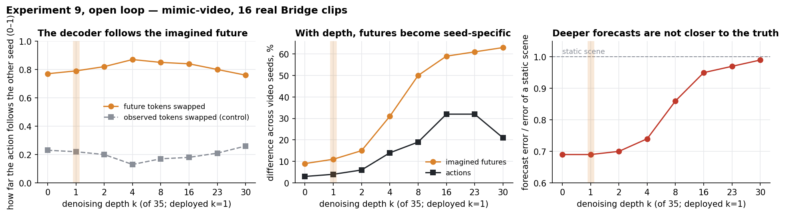
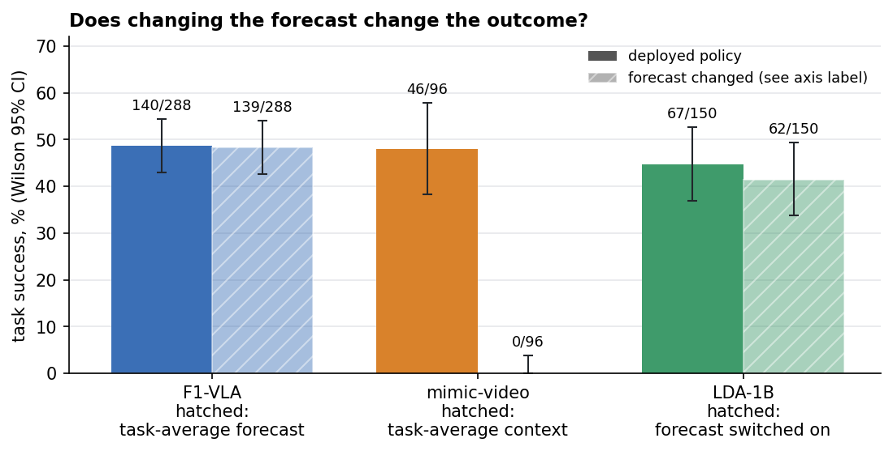

# Does Foresight Drive Action? Testing Whether Inference-Time World Models Are Causally Used by Vision-Language-Action Policies (working title)

*Working draft — skeleton. Each section holds a short placeholder text that
says what the section will argue. Numbers are copied from the experiment
records in the three model repositories (linked per section); where a
result is under re-check, the text says so.*

---

## Abstract

Several recent robot policies generate a prediction of the future — an
image, a video, or a latent forecast — before choosing an action. They
report better performance than action-only policies, but it is not clear
*why*. Either the policy actually reads its own forecast when it decides
what to do, or training to forecast simply teaches better internal
representations, and the forecast itself is unused at inference time.

This thesis separates these two explanations with one shared set of five
experiments, applied to three architecturally different models: F1-VLA,
mimic-video, and LDA-1B. We remove or replace the forecast (ablation),
feed the true future instead (oracle injection), measure what the forecast
costs (latency), probe what the internal representation encodes
(probing), and erase confounding information from it (concept erasure).

*Headline finding (to be finalized):* the three models disagree. F1-VLA
is blind to the content of its forecast: a wrong episode's forecast or the
task-average forecast leave success unchanged (+1.4 pp and −0.3 pp, 95% CIs
within about ±6 pp); removing the forecast tokens costs 14 pp, but only
because it changes the input's shape. mimic-video's decoder depends entirely on
its video model's context: every replacement, including on-distribution
ones that keep the decoder working normally, drops success from 48% to 0%.
But at its deployed operating point the forecast and the view of the
current scene live in the same tokens and cannot be removed separately, so
this does not show use of *predicted future* content. LDA-1B does not use
its forecast at inference at all: its action head barely reacts even to
the real next frame, or to its current frame given through the same input
(it sees the scene through its VLM instead), and turning the forecast on
does not help.

---

## 1. Introduction

### 1.1 Motivation
Robot foundation models increasingly "imagine before they act". This is
expensive: generating a forecast can multiply the time per decision. If
the forecast is not actually used, that compute is wasted, and the claimed
benefit of world models is really a training-time effect.

### 1.2 Research question
**Does the world-model computation performed at inference time carry
causal weight for action selection — or is the benefit entirely a
training-time representational effect?**

### 1.3 Approach in one paragraph
Instead of comparing models by their final success rate, we intervene on
the forecast inside each model and watch how the actions change, in
closed-loop simulation. Causal claims come only from closed-loop success
(or from actions compared at identical states), never from offline
prediction error on training data, which memorization can explain.

### 1.4 Contributions
1. A shared, model-agnostic protocol of five experiments for testing
   whether a policy uses its own foresight.
2. Its application to three models with different foresight mechanisms
   (image tokens, video-diffusion features, latent dynamics).
3. Evidence that "uses its world model" is not one property: the three
   models depend on foresight in qualitatively different ways.
4. Negative and methodological results recorded as findings, e.g. that
   LDA-1B's representation does not transfer across camera viewpoint.

### 1.5 Thesis outline
Chapter 2 reviews related work, Chapter 3 the three models, Chapter 4 the
shared protocol, Chapter 5 the results, Chapter 6 the follow-up
experiments, Chapter 7 discussion and limitations.

---

## 2. Background and Related Work

### 2.1 Vision-language-action policies
Policies that map camera images and a language instruction to robot
actions, usually built on a pretrained vision-language model. Key
reference point: π0 (Black et al., 2024), on which F1-VLA builds.

### 2.2 World models and foresight inside policies
The three models are chosen to cover the three classes of the taxonomy in
"World Action Models: A Survey" (Shen et al., 2026, arXiv:2606.20781),
which sorts methods by what they must generate at inference:
*Render-and-Decode* (the video backbone runs to pixel output before the
action — F1-VLA), *Latent-Only* (the inference path stops before pixel
decoding — mimic-video) and *Video-Generation-Free* (no video-generation
backbone on the predictive path; forecasting is learned in a feature latent
— LDA-1B). The survey argues the field is moving toward generating less of
the future while keeping what control needs; our Experiment 9 tests this
directly for mimic-video. *TODO: check each model's placement against the
survey's Tables 1–2.*

Models that predict future observations and condition actions on them:
F1-VLA (Lv et al., 2025, arXiv:2509.06951), mimic-video (Pai et al., 2025,
arXiv:2512.15692), LDA-1B (Lyu et al., 2026, arXiv:2602.12215). The papers
already contain versions of three of our experiments: mimic-video's oracle
case study (Sec. III; ground-truth future latents give near-perfect
success) and its sweep of the video flow time (Fig. 6; success peaks at the
noisiest setting), and F1-VLA's ablation table (2, 4 or 6 forecast scales
at inference; a No-Gen variant trained without the generation expert). They
are single runs on 24 episodes per task; our contribution is the paired
protocol and the tests that separate explanations (Sections 5–6).

### 2.3 Causal interventions on neural networks
Ablation and activation patching (Heimersheim & Nanda, 2024), interchange
interventions (Geiger et al., 2021), and the warning that zero-ablation can
push a network off its activation distribution.

### 2.4 Probing and concept erasure
Linear and nonlinear probes for what a representation encodes; LEACE
concept erasure (Belrose et al., 2023); amnesic probing (Elazar et al.,
2021) as the causal follow-up.

### 2.5 Evaluating robot policies in simulation
SimplerEnv (Li et al., 2024) for BridgeData V2 tasks (Walke et al., 2023);
RoboCasa (Nasiriany et al., 2024) for LDA-1B. Statistical reporting
following Agarwal et al. (2021).

*TODO: verify every citation against the published version and build the
bibliography.*

---

## 3. Models Under Study

One short section per model: what the forecast is, where it enters the
action decoder, and what "removing it" means mechanically.

### 3.1 F1-VLA
Three experts in one decoder-only transformer: understanding (image and
language), generation (next-scale VAR forecast of a future frame) and
action (flow matching), with attention flowing understanding → generation →
action only. The paper describes the forecast as decoded into a future
image that conditions the action. In the released code the image decoder
is not called: the action expert reads the keys and values of the forecast
positions in the shared cache. As the paper states, inference generates 4
of the 10 scales; of these, the tokens of scales 1–3 (14 tokens, finest
grid 3×3) reach the action expert and the scale-4 tokens are sampled but
not fed back. The generation block the action expert reads is 680 tokens of
history frames followed by 29 forecast positions. Finetuned by us on Bridge
(chunk size 4, 100k steps; 48.6% against the paper's 59.4%).

### 3.2 mimic-video
A video-diffusion backbone (Cosmos-Predict2) is partially denoised; hidden
activations from one layer (`crossattn_emb`) condition a flow-matching
action decoder through cross-attention. The paper calls the decoder an
inverse dynamics model. It is trained on activations computed from the
*ground-truth* future video noised to a random flow time, and is told that
flow time. Operating point: one denoising step (`stop=1`). Our baseline
reproduces the paper's SIMPLER-Bridge result (47.9% vs. 46.9%).

### 3.3 LDA-1B
One MM-DiT co-trained on four tasks — policy, forward dynamics, inverse
dynamics and visual forecasting in DINO latent space — selected by a task
embedding. The authors' inference uses the policy task only, with a
register token in the future-state slot. Our "forecast on" condition is our
own composition of two trained tasks: the visual-forecasting output is fed
to the inverse-dynamics task, which in training only ever saw the real
future frame. Pretraining data is mostly egocentric (the paper names this
as a limitation) but includes Open X-Embodiment. Our Bridge finetunes
reached 0%, cause not established (Section 5.6); experiments run on the
authors' RoboCasa checkpoint (48% baseline).

---

## 4. Shared Experimental Protocol

### 4.1 Benchmarks and tasks
SimplerEnv-Bridge, four tasks × 24 episodes (F1-VLA, mimic-video);
RoboCasa-GR1 tabletop tasks, 50 episodes (LDA-1B).

### 4.2 The five experiments
1. **Ablation** — remove or replace the forecast; measure closed-loop
   success.
2. **Oracle injection** — feed the true future through the model's own
   pipeline; compare the resulting actions.
3. **Cost per decision** — latency with and without the forecast.
4. **Representation probing** — can current and future end-effector pose
   be decoded from a frozen hidden state?
5. **Concept erasure** — erase episode identity (LEACE); does pose become
   decodable?

### 4.3 What counts as evidence
Closed-loop success, or actions compared at identical states. Offline
prediction error on training episodes is not used anywhere (no held-out
split, memorization-confounded).

### 4.4 Statistics (shared rule for all experiments)
Every condition runs on the same task instances and simulator seeds as
its baseline. For RoboCasa this required seeding the scene of every
episode ourselves: the published evaluation client leaves it random. We report successes out of total trials, paired differences
between conditions, and confidence intervals (Agarwal et al., 2021). Small
gaps such as 48.6% vs 50.0% are only interpreted if the interval excludes
zero. *Older runs predate this rule; their baselines will be re-run.*

### 4.5 Reporting by task type (shared rule)
Results are reported per task and per task type, not only as an average.
SimplerEnv-Bridge offers only four short pick-and-place tasks (stacking is
the most contact-heavy), so a full split into reaching, contact-heavy and
long-horizon tasks is only possible on RoboCasa.

---

## 5. Results

### 5.1 Experiment 1 — Ablation
- *Under correction (2026-11-15): the internal diagnostics below split the
  generation block wrongly (it is 680 history tokens followed by 29 forecast
  positions, not 30 + 679). The attention share and the 1–3% / 38% change
  figures will be recomputed; the closed-loop numbers are unaffected.*
- **F1-VLA:** removing the foresight tokens lowers success from 140/288
  (48.6%) to 100/288 (34.7%): −13.9 pp, paired 95% CI [−20.1, −7.3]. A
  foresight from a wrong episode gives 144/288 (50.0%): +1.4 pp [−3.1,
  +5.9], indistinguishable from baseline, and only 44 of 288 paired
  episodes change outcome. Replacing the foresight with its task average
  — same length, positions and masks, no episode content — gives 139/288
  (−0.3 pp [−4.5, +3.8]), so the removal cost comes from the unseen,
  shorter sequence, not from lost information. The model does not use the
  content of its foresight at inference: it needs the slot filled, not
  informative. Internal diagnostics (1800 replans on identical inputs)
  explain both halves: removal also shifts the action tokens' position
  ids by ~709, a layout never seen in training; and although the action
  queries put ~28% of their attention on the generated future tokens,
  their output barely depends on what those tokens contain. They also
  show that the wrong-episode replacement was a weak test (it changes the
  future tokens' keys and values by only 1–3%), so the content-blindness
  claim rests on the task-average replacement, which changes them by up
  to 38%.
- **mimic-video:** every intervention on the forecast gives 0% (baseline
  46/96 = 47.9%, rerun on identical episodes). A sanity check requested by
  the advisor shows that plain zeroing is not clean evidence: it makes all
  context tokens identical, cross-attention uniform, and the decoder's
  rotations invalid — the computation breaks. But controls that keep the
  decoder on its normal activation range collapse just as completely:
  the task-average forecast (0/96; the robot barely moves), a
  coherent clip from another episode, and the original per-step shuffle
  (both 0/96, paired difference −47.9 pp, 95% CI [−56.2, −39.6]). Under
  the shuffles the robot moves normally but never touches the correct
  object. Reusing the episode's own first forecast for the whole episode
  also fails (0/96), though it is the only intervention that still
  reaches the correct object sometimes (12/96). But the context these
  interventions replace is the decoder's only view of the scene and the
  task, so they remove perception together with the forecast. A follow-up
  test (16 real Bridge clips, open loop) shows the two cannot be separated
  at the deployed operating point (`stop=1`, sigma 68 of 80): the decoder
  reads almost everything from the 14 future frames' tokens (dropping the
  observed frames' tokens changes the action by 5%), and those tokens start
  from input-independent noise, so what they carry is the video model's
  processed view of the observed frames and the prompt. Every way of
  removing the future — dropping it after the video model, running the
  video model on the observed frames only, or swapping in the average
  future — gives a near-static policy (translation 0.004–0.027 vs 0.069).
  Conclusion: mimic-video's decoder depends on the video model's context,
  but Experiment 1 cannot show that it uses *predicted future* content;
  that question moves to Experiment 9 (how far the forecast is generated).
- **LDA-1B:** turning the dormant forecast *on* gives 62/150 vs 67/150
  for the baseline on identical scenes (−3.3 pp, 95% CI [−12.7, +6.0],
  p = 0.58): no measurable effect. The original 44% vs 48% compared
  different random scenes, because the authors' RoboCasa client never
  seeded its environment; the rerun fixes the scenes per episode.
  Internal diagnostics (180 decisions on identical states) show the
  world-model-on path runs correctly — expected shapes, no attention
  masks, the forecast in the same range as a real next frame (cosine
  0.88) and contributing ~29% of the merged observation tokens — but the
  action head barely reacts to it: replacing the forecast with the real
  next frame, zeros, noise or another episode's forecast changes the
  16-step action chunk by 0.06–0.29% (relative L2), against 133% between
  consecutive decisions. A positive control shows the measurement can
  detect an effect — swapping the whole image input changes the action by
  up to 46% (90th percentile 20–36%), mostly early in the episode — but
  replacing the *current* frame's tokens at the same input the forecast
  uses barely matters either (zeros: 0.24%, another episode's frame:
  0.02%). The action head ignores the visual tokens it receives directly,
  forecast and current frame alike; vision reaches the action through the
  VLM features.

*Figure: Experiment 1. Closed-loop success after replacing or removing the forecast, with Wilson 95% intervals. Grey: the deployed policy on the same episodes.*

### 5.2 Experiment 2 — Oracle injection
- **F1-VLA:** the oracle's action is close to the real policy's own
  action — consistent with content mattering little.
- **mimic-video:** the oracle's action is ~5–9× closer to the policy's own
  action than a zero-action guess; with Experiment 1, this suggests the
  model's own forecast is already close to correct.
- **LDA-1B:** oracle and forecast actions are both worse than a zero-action
  baseline (0.90 vs 0.75 L1), and far from each other: the content of the
  fed-in future changes this pathway's output.

*Figure: Experiment 2. Change of the action when the model is given the real future, next to a reference size for each model (live probes; actions are compared at identical states, never to dataset actions).*

### 5.3 Experiment 3 — Cost per decision
F1-VLA 215.7 ms median per control step; mimic-video 1060 ms per decision
at `stop=1` (~4–5× F1/LDA); LDA-1B 254.7 ms, rising to 428.2 ms (+68%)
with the forecast turned on.

*Figure: Experiment 3. Median latency of one decision.*

### 5.4 Experiment 4 — Representation probing
F1-VLA and mimic-video: current pose is not recoverable (worse than a
constant predictor), with linear and MLP probes alike. LDA-1B: an MLP
recovers both current and future pose where ridge regression fails.

*Figure: Experiment 4. Gain of a pose probe over a constant predictor on held-out episodes; below zero means the pose cannot be read.*

### 5.5 Experiment 5 — Concept erasure
F1-VLA and mimic-video: erasing episode identity does not make pose
recoverable — the "masking" explanation is refuted. LDA-1B: most of the
MLP's current-pose signal turns out to be a linear direction ridge missed;
future pose keeps a smaller nonlinear residual.

*Figure: Experiment 5. Left: episode-identity accuracy before and after LEACE erasure. Right: the pose probe before and after erasure.*

### 5.6 LDA-1B and camera viewpoint
Swapping RoboCasa's egocentric camera for a third-person one drops success
from 48% to 0/50, with a self-occlusion caveat. This shows that a
checkpoint finetuned on egocentric frames does not work zero-shot from
another viewpoint; it does not explain the Bridge 0%, where the model was
finetuned on third-person frames and had seen such data in pretraining.
The cause of the Bridge result is not established (viewpoint and
pretraining, or a data-pipeline difference — Experiment 12).

*Figure: LDA-1B on RoboCasa with its training (egocentric) camera and with a third-person camera.*

*Sources: `eval/bridge/EXPERIMENTS.md` and `experiment*/README.md` in each
repository; `LDA-1B/eval/robocasa/RESULTS.md`.*

---

## 6. New Experiments (from the advisor's list, in progress)

Follow-ups that ask a new question get their own experiment number. The
ablation sanity check stays part of Experiment 1, and paired statistics
and per-task reporting are shared rules (Sections 4.4–4.5).

### 6.1 Experiment 6 — Graded foresight replacement
Replace the native forecast with one from the same task and scene, a
different task in the same scene, or an unrelated scene. Compare actions
at identical saved states, then run the most informative conditions in
closed loop. Extends Experiment 1's shuffle into a scale of "how wrong";
method: interchange interventions (Geiger et al., 2021).

### 6.2 Experiment 7 — Horizon-shifted foresight
Inject futures predicted for earlier or later horizons than the action
branch expects: does the *timing* of the predicted event matter?

### 6.3 Experiment 8 — Instruction–foresight conflict
Keep the observation, change the instruction, compare futures and actions;
then swap the futures between instructions. Does the action follow the
goal, the foresight, or both? (Cue-conflict design, Geirhos et al., 2019;
the swap is an interchange intervention, Geiger et al., 2021.)

*F1-VLA, single decisions (1785 replanning decisions, 4 tasks).* The
instruction reaches the action expert directly (language tokens in the
understanding block) and through the forecast (the generation block is
produced while attending to the language). On the same observation, the
same forecast sampling seed and the same action start noise, the policy is
run under the scene's instruction A and under an instruction B, and the
action is decoded again from every combination of "understanding block of
one run, generation block of the other". B is either the mirrored
instruction (the two objects swapped, e.g. "stack the yellow block on the
green block"; same token count, so no position shifts) or the instruction
of another task.

- *The instruction changes the forecast less than resampling does.* A
  different instruction changes 11–22% of the 30 forecast tokens; a
  different sampling seed under the same instruction changes 67–74%.
- *The action follows the instruction it reads directly.* Changing the
  instruction everywhere moves the action chunk by 1.0–2.0 (mean L2 per
  step, normalised units). Putting the generation block of the other
  instruction under an unchanged understanding block moves it by
  0.004–0.010, and swapping only the 29 forecast positions by 0.003–0.006
  — the size of the change caused by a re-drawn forecast under the same
  instruction (0.003–0.005). The share of the way the action moves towards
  the forecast's instruction is 0.01–0.02 in all 16 instruction pairs, in
  both directions.
- *Layout confirmed from data.* Two sampling seeds never differ before
  position 984 of 1013: the generation block is 680 history positions
  followed by 29 forecast positions.

These are single decisions; whether small differences add up over an
episode is tested in closed loop (the robot driven by each of the four
combinations, mirrored instruction, 4 tasks × 24 episodes — running). The
mirrored instructions are unusual for Bridge, so the closed loop also
checks which object the robot goes for under B alone. mimic-video and
LDA-1B: not done.

*Figure: Experiment 8, F1-VLA, single decisions with the mirrored instruction. Left: share of forecast tokens that change with the sampling seed and with the instruction. Right: change of the action chunk when the instruction is changed everywhere, when only the generation block or only its forecast positions come from the other instruction, and between two forecast seeds (noise floor). Bars: mean over episodes, 95% bootstrap interval.*

### 6.4 Experiment 9 — Compute–performance trade-off
Vary generation steps, prediction detail and replanning frequency; plot
task success against full inference latency. Builds on Experiment 3 and on
mimic-video's own denoising-depth analysis.

*mimic-video, open loop (16 real Bridge clips).* The decoder reads the
video model's activations after step k of 35 (deployed: k=1). Changing only
the video model's random seed keeps perception identical and changes only
the imagined future. Swapping in another seed's future tokens moves the
action ~80% of the way to that seed's action (observed tokens: ~20%) at
every depth, in 16/16 clips: the decoder follows the imagined future. With
depth the imagined futures become specific (they differ across seeds by 9%
at k=0, ~60% from k=16) and the action follows suit (4% at k=1, 32% at
k=16–23), while the forecast does not get closer to the real future and
latency grows from 1.4 s (k=1) to 13 s (k=23). Given the real future
instead, the decoder acts about as differently as between two seeds. An
earlier unpaired run found success falling from 47.9% at k=1 to 11.5% at
k=23; the open-loop result suggests why — deeper forecasts commit to one
specific future, no closer to the truth, and the decoder follows it.

*Figure: Experiment 9, open loop. Left: how far the action follows another video seed when its future tokens (or, as a control, its observed tokens) are swapped in. Middle: difference between video seeds. Right: forecast error relative to a static scene.*

*mimic-video, closed loop (96 SimplerEnv Bridge episodes, paired with the
deployed k=1).* Success is flat for k=0–4 (44.8%, 47.9%, 49.0%, 42.7%;
every paired CI contains 0) and then falls: k=8 31.2% (−16.7 pp
[−26.0, −7.3], McNemar p=0.014), k=16 9.4% (−38.5 pp [−47.9, −29.2],
p<0.0001), while latency per decision grows from 1.4 s to 9.3 s. SimplerEnv
waits for the model, so the drop comes from what the decoder receives, not
from delay. Failures start early — at k=16 the correct object is grasped in
28/96 episodes vs. 61/96 at k=1. The deployed k=1 is therefore also the
best measured point: extra generation buys no success. The collapse sits
exactly where the open loop showed futures becoming seed-specific and the
action following them. Two causes remain unseparated: committing to one
wrong future, or a train/test mismatch (at low noise the decoder was
trained only on the real future). Averaging the action over four video
seeds at k=16 separates them: success returns to 47/96 = 49.0% (+39.6 pp
[+29.2, +50.0] against the single seed, p < 0.0001; +1.0 pp [−10.4, +12.5]
against k=1). The mismatch is present in each of the four calls, so the
single-seed collapse is the decoder committing to one imagined future. This
does not make deep forecasts useful: four of them (about 4 × 9.3 s) only
match what k=1 gives in 1.4 s. Replanning rate at k=1: executing 10 of the
15 planned actions instead of 5 gives 38/96 (−8.3 pp [−17.7, +1.0],
p = 0.15). Executing only 1 or 2 gives 0/96, and a diagnostic shows why:
in the deployed setting the gripper-close command sits in the later steps
of the executed plan (share of "close" by plan step 1–5: 0.07, 0.10, 0.08,
0.25, 0.35), and the first step moves the arm about a third as fast, so a
controller that only ever executes step 1 never grasps (0 grasps in 96
episodes). Replanning at every step but executing the pose and gripper of
plan step 5 brings grasps back to 45/96 (deployed: 61/96) and success to
17/96 (−30.2 pp [−40.6, −19.8] against deployed); shifting the pose alone
gives 2/96. The zero is therefore a property of where the grasp sits in the
plan, not evidence against frequent replanning; the remaining gap is
unexplained (on Carrot the arm's path per episode is about 1.5 times
longer than in the deployed setting, 58 cm against 39 cm, which may reflect
a newly imagined future at every call — not tested). Forecast detail is not varied for mimic-video:
resolution and clip length are fixed, the decoder was trained on a context
of exactly that size, and changing it would alter the input layout rather
than only the forecast's content (the confound of Section 7.1).

*Figure: Experiment 9, closed loop. Left: success against latency per decision for denoising depths k=0–16, and for k=16 with the action averaged over four video seeds. Right: success against the number of planned actions executed per decision; the last bar replans at every step but executes plan step 5 (pose and gripper).*

### 6.5 Experiment 10 — Perturbed starts and object displacement
Evaluate from perturbed starting states or after moving an object mid-
episode: is foresight most useful when the robot has to adapt?

### 6.6 Experiment 11 — Matched action-only baseline (if compute permits)
Same data and training budget without a generation branch (for F1-VLA:
π0), compared with the jointly trained model with and without its
generation branch at inference.

### 6.7 Experiment 12 — BridgeData pipeline audit
Episode overlap, language annotations, frame sampling, action coordinates
and orientation corrections across the two Bridge processing pipelines
(`bridge_orig_lerobot` and LDA-1B's converted copy).

---

## 7. Discussion

### 7.1 Three models, three kinds of dependence
Content-blind but shape-dependent (F1-VLA), context-dependent with
forecast and perception inseparable (mimic-video), and unused at inference
(LDA-1B). A methodological lesson from both forecast-using models: removing
or zeroing the forecast breaks the decoder's input distribution and
overstates (F1) or confounds (mimic-video) the effect; on-distribution
replacements are the reliable test, and only where the forecast is
carried separately from perception (F1's foresight tokens, LDA's
next-observation slot).

*Figure: Deployed success of each model next to its cleanest forecast-changing condition.*

### 7.2 What this means for "world models help robots"
The benefit can come from training, from inference, or both — and which
one is model-specific.

### 7.3 Limitations
Simulation only; one benchmark per model; small episode counts; LDA-1B
evaluated on RoboCasa rather than Bridge; our F1-VLA finetune is
undertrained relative to the paper (0.85 vs ~10 epochs).

---

## 8. Conclusion

*One page: the answer to the research question for each model, and what a
future world-model policy should be tested for.*

---

## Appendix

- **A. Reproducibility.** Repositories, branches, checkpoints, and the
  scripts that rebuild every environment and dataset.
- **B. Debugging records.** Operating-point correction for mimic-video
  (`stop=1` vs `stop=23`), LDA-1B's Bridge 0% diagnostic trail.
- **C. Negative results.** chunk size 8/30 for F1-VLA; offline probes
  (excluded from evidence, kept for the record).
